

  

  
  
  

> **Fork note (`v4.47.1-ua-branch`):** personal daily-driver branch by
> [uaparit](https://github.com/uaparit), the build actually flashed to the watch. Based on
> [`v4.47.1`](https://github.com/coredevices/PebbleOS/releases/tag/v4.47.1). Released builds are
> tagged `v4.47.1-uaX.Y` on this branch (see
> [Releases](https://github.com/uaparit/PebbleOS/releases)) — the branch name itself doesn't
> carry a patch number, since a new `ua` tag doesn't always mean new commits here (e.g. a
> rebuild with a different compile flag).
>
> Text Size (Settings → Display) and, as of `v4.45.0`, Dark Mode and the Accent Color picker
> (Settings → Themes) are upstream features. This branch uses them as they are and no longer
> carries its own Light/Dark background switch.
>
> Added on top:
> - an "Invert" entry in the Accent Color list: highlights follow the text color instead of a
>   fixed hue, black in light mode and white in Dark Mode
> - the Settings menu's icons are enabled (existing, otherwise unused firmware feature)
> - a Bold Subtitles toggle (Settings → Display): bolds menu cell subtitles system-wide, for
>   readability
> - the Health app now always cycles between cards (Steps/HR/Sleep), regardless of how it was
>   launched — quick-launching it via a directional button used to exit to the watchface at the
>   list boundary instead of wrapping
> - Send Text's "no contacts" screen follows Text Size too
> - installing any firmware over this one activates it on the next boot. Builds that aren't on an
>   exact release tag get a boot priority above every official release, so without this an
>   official firmware with the same or a higher version number was written but never booted
> - microphone selection and gain (Settings → System → Debugging, Pebble Time 2): "Microphone"
>   switches capture from the primary to the secondary of the two built-in microphones, "Mic
>   Gain" raises the input gain from the default up to +15 dB in 3 dB steps. Both apply to
>   dictation, voice replies and apps from the next recording on — meant for watches whose
>   primary microphone has become weak
> - voice is encoded at 12.8 kbps (Speex wideband quality 4) instead of 9.8 kbps, with a higher
>   encoder complexity. The 9.8 kbps bitrate silently overrode the configured quality, so
>   recordings were actually encoded at quality 3
>
> See the commit history for full details.

### Text Size screenshots

Captured under QEMU (`qemu_emery`, same 200×228 display as `obelix`/Pebble Time 2), one column
per Text Size setting. "Smaller"/"Default"/"Larger" are the labels shown in the Settings app;
they map to the `PreferredContentSize` tiers `Medium`/`Large`/`ExtraLarge` (`Large` is the
default on rectangular displays).

| | Smaller (`Medium`) | Default (`Large`) | Larger (`ExtraLarge`) |
|---|---|---|---|
| Main menu | 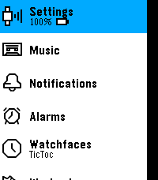 | 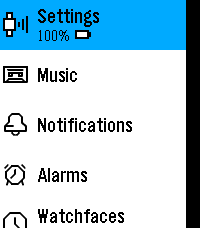 | 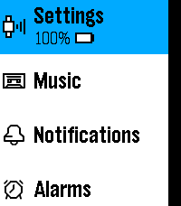 |
| Settings menu | 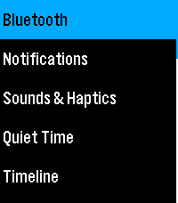 | 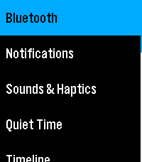 | 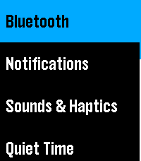 |
| Watchfaces menu | 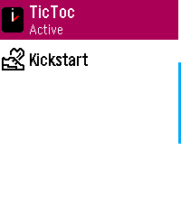 | 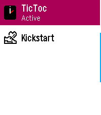 | 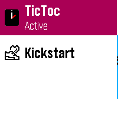 |
| Display menu | 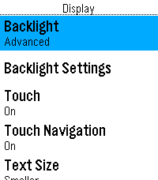 | 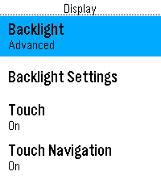 | 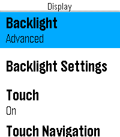 |
| Bluetooth | 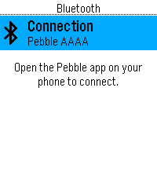 | 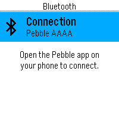 | 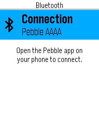 |

## Resources

Here's a quick summary of resources to help you find your way around:

### Getting Started

- 📖 [Documentation](https://pebbleos.readthedocs.io/latest)
- 🚀 [Quickstart](https://pebbleos.readthedocs.io/latest/getting_started/index.html)

### Code and Development

- ⌚ [Source Code Repository](https://github.com/coredevices/PebbleOS)
- 🐛 [Issue Tracker](https://github.com/coredevices/PebbleOS/issues)
- 🤝 [Contribution Guide](CONTRIBUTING.md)

### Community and Support

- 💬 [Discord](https://discordapp.com/invite/aRUAYFN)
- 👥 [Discussions](https://github.com/coredevices/PebbleOS/discussions)
